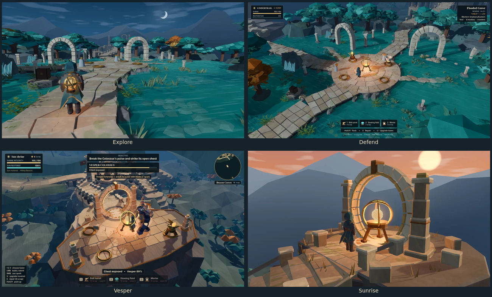
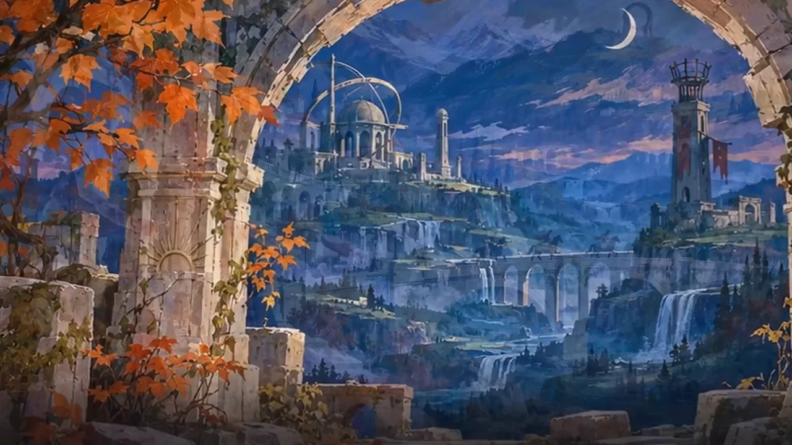
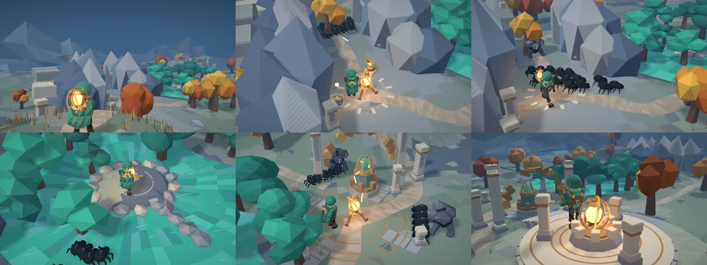
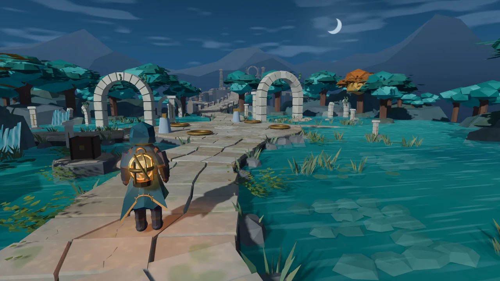
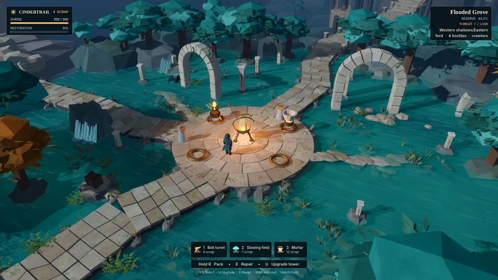
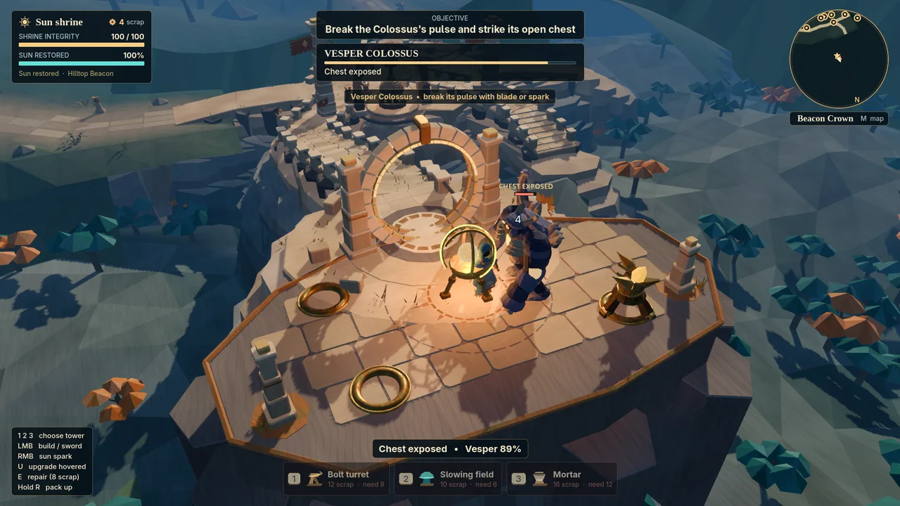
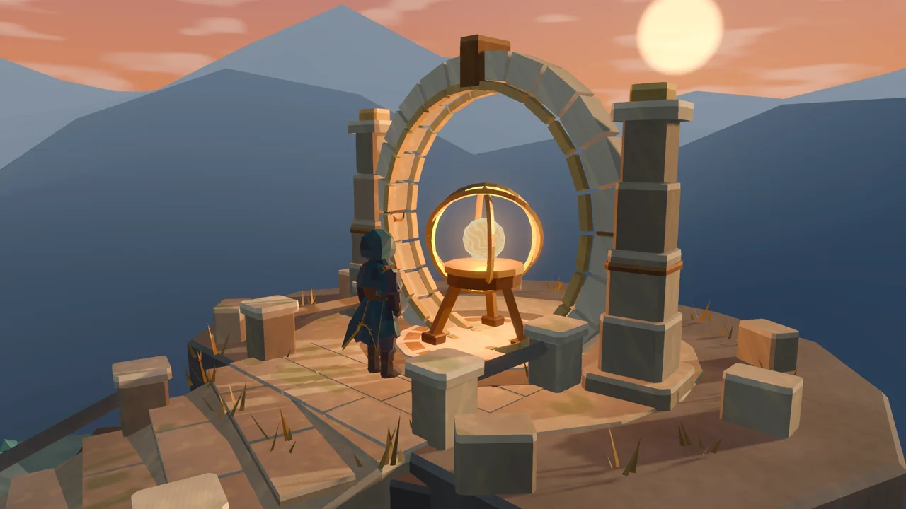

# CINDERTRAIL — Carry the Last Sunrise

An open-world, portable-base tower-defense adventure. Explore a continuous 3D valley from a free third-person camera, deploy the one sun shrine at a chosen site, defend from a fixed angled camera, then pack and relocate before the position becomes untenable.

## Browser showcase

The [showcase](showcase/) opens on the valley’s original concept art. Choose a landscape, scroll through the field guide to compare illustrations with in-game captures, or rotate the bronze shrine from the game. **Watch trailer** plays the 30-second concept film. **Play in browser** launches the original Godot game with a keyboard and mouse.

Run from the repository root with Python 3, curl, unzip, split and sha256sum available.

```sh
sh deploy/web/prepare-game.sh
python3 -m http.server 8000 --directory showcase
```

Open [localhost:8000](http://localhost:8000/). The preparation script verifies the pinned official release and writes its runtime to an ignored directory. The site loads the game only on request. The first launch downloads about 169 MiB before HTTP compression. Desktop play requires WebGL 2. Use **Esc** to pause the game and **F8** to return to the showcase. The guide and trailer also work on touchscreens.

The existing [Docker deployment](deploy/web/Dockerfile) builds the same site with precompressed game files. The launcher caps the drawing buffer at a 720p pixel budget, and the page suspends its 3D viewer and soundtrack while the game is open. Reduced-motion preferences disable parallax and automatic rotation.

The showcase uses the repository’s original concept boards, gameplay stills, concept trailer, and shrine geometry. Its optional soundtrack is an edited excerpt of Scott Buckley’s [Memories of Stone](https://www.scottbuckley.com.au/library/memories-of-stone/), licensed under [CC BY 4.0](https://creativecommons.org/licenses/by/4.0/). Font and Three.js licenses are included alongside their local files.

## Watch

| Gameplay · full run | Intro film | Original concept trailer |
| --- | --- | --- |
| [](media/Cindertrail_Gameplay.mp4) | [](CINDERTRAIL_The_Morning_That_Never_Came_720p.mp4) | [](media/CINDERTRAIL_Concept_Trailer.mp4) |
| [Watch the 104-second gameplay capture with game audio](media/Cindertrail_Gameplay.mp4) | [Watch the 122-second intro film](CINDERTRAIL_The_Morning_That_Never_Came_720p.mp4) | [Watch the original 30-second trailer](media/CINDERTRAIL_Concept_Trailer.mp4) · [Trailer contact sheet](media/trailer_contact_sheet.jpg) |

## Screenshots

Captured from the playable Godot project. Open any image for its full-size view.

| Exploration | Shrine defense |
| --- | --- |
|  |  |

| Vesper fight | Sunrise ending |
| --- | --- |
|  |  |

## Play

Open [project.godot](project.godot) in Godot 4.7.2 and press **F5**, or run these commands from the project directory.

```sh
godot --headless --editor --path . --import
godot --path .
```

The project uses the Mobile Vulkan renderer. Run it from Godot to play the current source milestone.

The title opens on the Flooded Grove. **New Journey** starts the twelve-page illustrated prologue. **Continue Journey** resumes at the last safe checkpoint. A checkpoint preserves your trail position, shrine health, restoration, scrap, modules, caches, unlocked shortcuts, remaining camp reserves and local threat. The game saves when you are carrying the shrine on safe ground after breaking pursuit.

Press **H** to ask Mote, the moth companion, for a tip about your current objective. Mote gives advice offline and can generate trail dialogue with a local OpenAI key. The narrated showcase runs from the prologue through sunrise and loops in one window. [Mote setup and showcase controls](docs/MOTE_AND_SHOWCASE.md)

The six main camps share one continuous 3D world and all use the same protected sun. Each main camp has 25 points of restoration. Expect quick attacks and a short break after each cleared wave. Drain four main camps or combine partial reserves, then bring the sun to the hilltop beacon.

**New Journey** gives each of the seven shrines a different area of the valley and samples its exact position on solid ground. Look for new trail markers, ruined workshops, overlooks, and side caches along the way. The Grove approach is still your starting point. Continue and Retry restore the same positions and routes, and older journeys retain their original geography.

The score changes as you explore, defend, flee, and face Vesper. Use **Settings** to adjust Music, Effects, and Ambience separately. [Soundtrack credits](art/audio/score/README.md)

Fully draining a shrine raises the cap of all three defenses by one level and earns that shrine's traveler ability. Use **G** to cast and **Q** to cycle. Each ability has its own cooldown in the icon dock. The first time you learn an ability, it earns a permanent achievement. Individual tower upgrades still cost scrap. At 100% restoration the beacon opens. Press **T** at an unfinished shrine to keep earning its local reward.

Camp landmarks can swing a wave. Press **E** at a bell, crane, relay switch, lantern, sluice wheel, or mirror control. At Fallen Relay, aim the pointer at the lane you want to pulse. Follow the moths in Lanternwood and align the Sunwatch mirrors during exploration to prepare those defenses.

Follow the spillway off **Tanners’ Road** to reach Last Lantern. Each journey assembles two different frontier trails with discoveries and an optional 10-point camp. Watch for tracks at turnoffs. You can follow the road past a resting pack, approach it, or fire a spark to draw it out. Clearing a pack earns scrap once. Continue restores the creatures you cleared as well as your discoveries.

Hold still to watch fish school beneath the Grove crossing, deer browse in Lanternwood, or otters surface in the Aqueduct. Movement and nearby fighting startle the wildlife. In defense, follow the light flowing out of the terrain into the shrine to see when it is drawing energy.

| Creature | Tell and response |
| --- | --- |
| Ford Skimmer | Its cyan joints flare in the shallows. Cover the dry exit where it slows. |
| Quarry Ram | It stamps and lowers its horns. A slowing field breaks the charge. |
| Splinterback | Its crystal fan opens over a marked landing zone. Interrupt the wind-up or carry the sun out of the mark. |
| Bell Warden | The bell opens around its chime and shields an ally. Strike the Warden to break the ward. |

At full restoration, follow the compass to the hilltop beacon. Press **E** to unfold the shrine on its summit, place any carried modules, then press **T** to challenge the **Vesper Colossus**. Evade its charges and ground ring. Move to the lit shoulder and strike or spark twice while it braces, then attack the open chest. After it falls, approach the cradle and press **E** to deliver the sun and begin the painted finale. Press **Esc** or **Enter** to skip to sunrise. Folding the shrine lets you retreat and attempt the defense again. If the core falls, **Retry from checkpoint** returns to the pre-fight journey.

| Input | Action |
| --- | --- |
| **WASD**, mouse, **Ctrl** | Move, look, and walk |
| **Space**, **Shift** | Jump. Press Shift to dash and hold it to sprint |
| **E** | Use a nearby landmark, unfold the shrine, collect supplies, repair, or deliver the restored sun |
| **1 / 2 / 3**, left click | Select a module, then place it on an open socket |
| **T** | Start a defense or resume extraction |
| **U** | Upgrade the tower under the pointer |
| **G**, **Q** | Cast or cycle earned shrine abilities |
| Left click or **F** | Tap for a draw cut, rising backhand, and leaping slam. Swing out of a dash for Sunwake Cut or swing on the way down from a jump for Falling Star. Hold until the blade chimes, then release for a spinning slash. With a module selected, left click places it |
| **H** | Ask Mote what to do next |
| Right click | Sun spark, a weak ranged shot toward the camera or pointer |
| **M** | Open the full valley map. The corner minimap turns with the camera and pins your objective to its rim |
| **Hold R** | Recall modules and fold the shrine near its pad |
| **Esc**, **Enter** | Pause or resume. Enter activates the focused menu action |
| **F10** | Toggle HUD visibility |

Repairs spend scrap to restore shrine health. Energy drawn from a camp advances the journey toward sunrise.

See the [roaming valley and score verification](docs/ROAMING_VALLEY_VERIFICATION.md), [Traveler’s Reckoning screenshots](docs/TRAVELER_RECKONING_VERIFICATION.md), [repeatable QA commands](tools/qa/README.md), and the original [visual fieldbook](OPEN_ME.html).

## Included

- `art/concept/`: all 16 canonical concept boards, given descriptive filenames.
- `art/archive/`: 2 earlier image variants retained for completeness; corrected canonical versions take precedence.
- `media/`: the user's original 30-second concept trailer and a quick six-frame contact sheet.
- `docs/`: design, MVP, architecture, art direction, acceptance checks, material pipeline, asset licensing, skills/MCP setup and trailer reference notes.
- `prompts/`: coding kickoff, art-production briefs and trailer prompt.
- `art/materials/`, `art/models/`, `scripts/`: actual starter assets and reproducible generation/import workflows. Read their status notes before assuming a resource is production-ready.
- `configs/`: example MCP configuration. Installing optional MCP servers is a separate action on your development machine.
- `PACKAGE_MANIFEST.json`: original starter-pack file sizes and SHA-256 hashes.

## Scope and visual standard

The corrected stills are the visual target. The included concept trailer is a pacing reference. The generated traveler, palette materials and refined starter meshes preserve the teal cloak, cream masonry, bronze shrine and blue-green night color family.

The [original starter guide](START_HERE.md) and the [numbered design documents](docs/) describe the intended game. The [starter validation](VALIDATION.md) records asset checks from packaging. Optional third-party maps retain their original provenance and licenses.
