# Concept Art Catalogue

Sixteen canonical boards and two earlier variants are included. All were generated during this project conversation. They are visual references, not implemented screenshots, UV textures or rigged 3D models.

## Carry the Last Sunrise

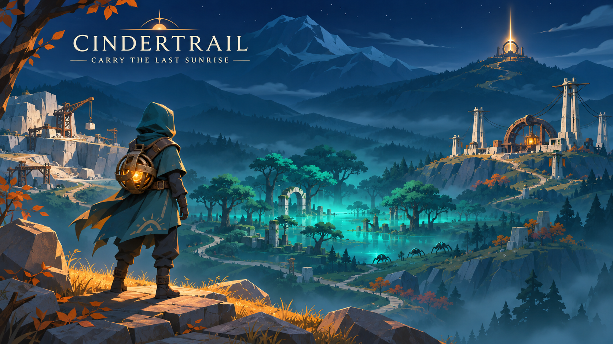

Master palette, traveler silhouette, valley scale and protected light.

## The Connected Valley

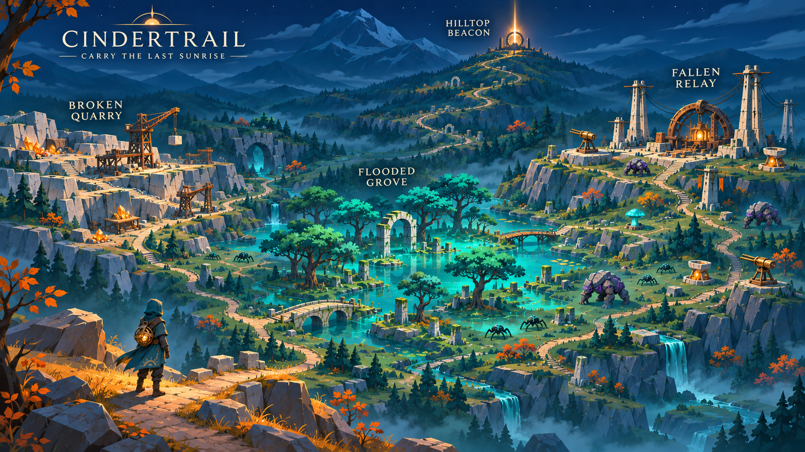

Connected terrain and route choices; this is an illustrative world plan.

## Traveler and Sun Shrine

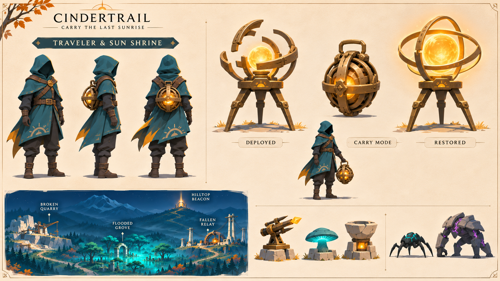

Character identity, deployed tripod, folded carry mode and restored sun.

## Broken Quarry Defense

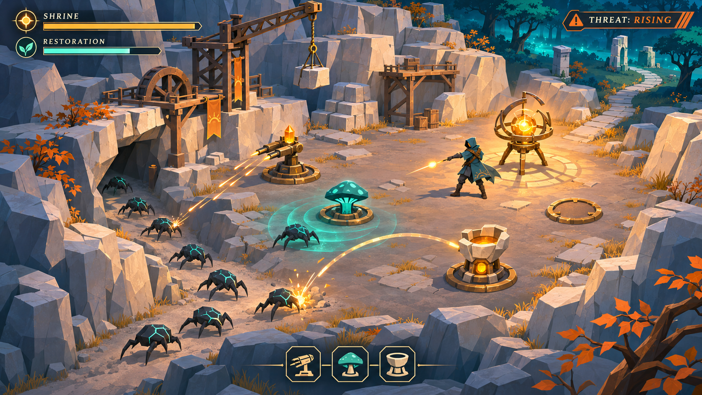

Narrow approach, pale stone, dry sockets, warm/cool combat readability.

## Flooded Grove Defense

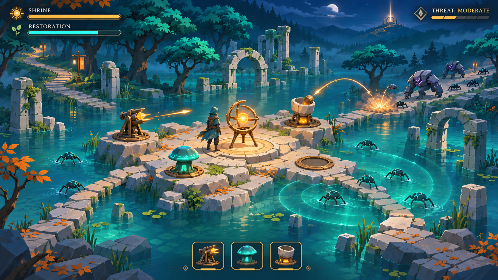

Water routes, dry deployment island and cyan slowing field.

## Fallen Relay Defense

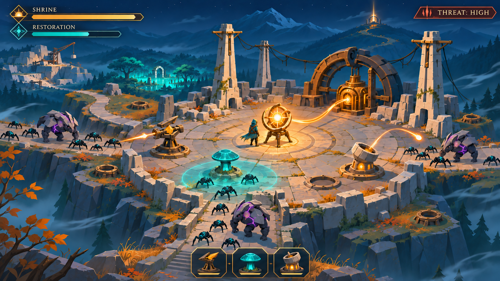

Three exposed approaches and generator-fed restoration. Corrected one-core version.

## Defense Modules

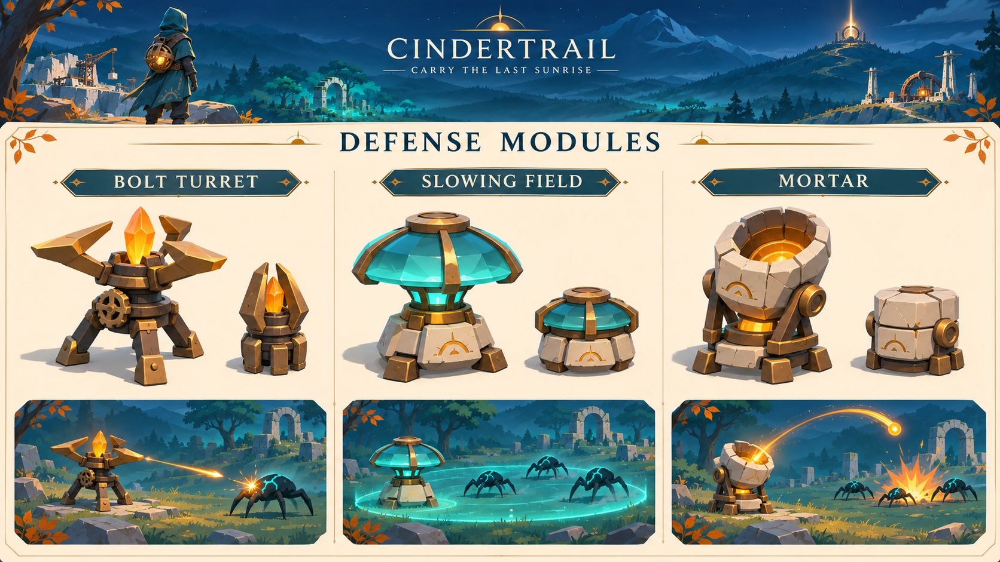

Bolt turret, slowing emitter, mortar and their compact forms.

## Creatures of the Dark

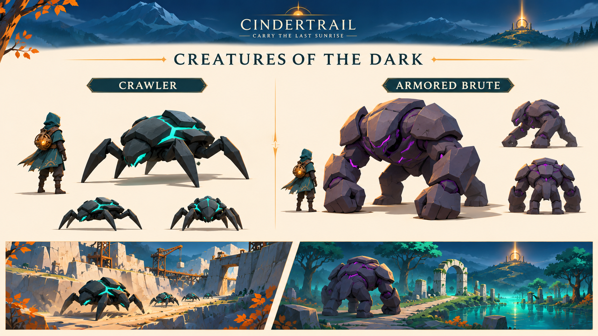

Crawler and armored brute silhouette and material targets.

## Defend, Relocate, Survive

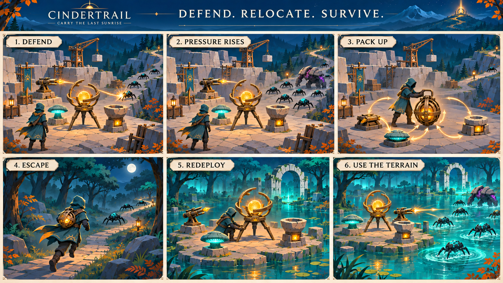

Core loop from quarry defense through packing, travel and redeployment.

## Delivered Sunrise

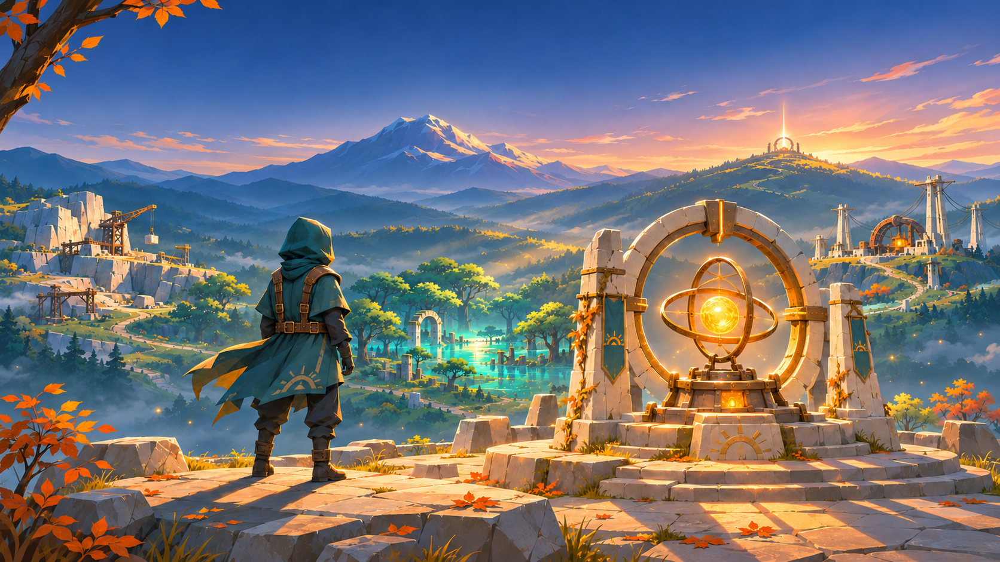

Final visual payoff. Corrected version: core delivered, harness empty.

## The Valley Opens

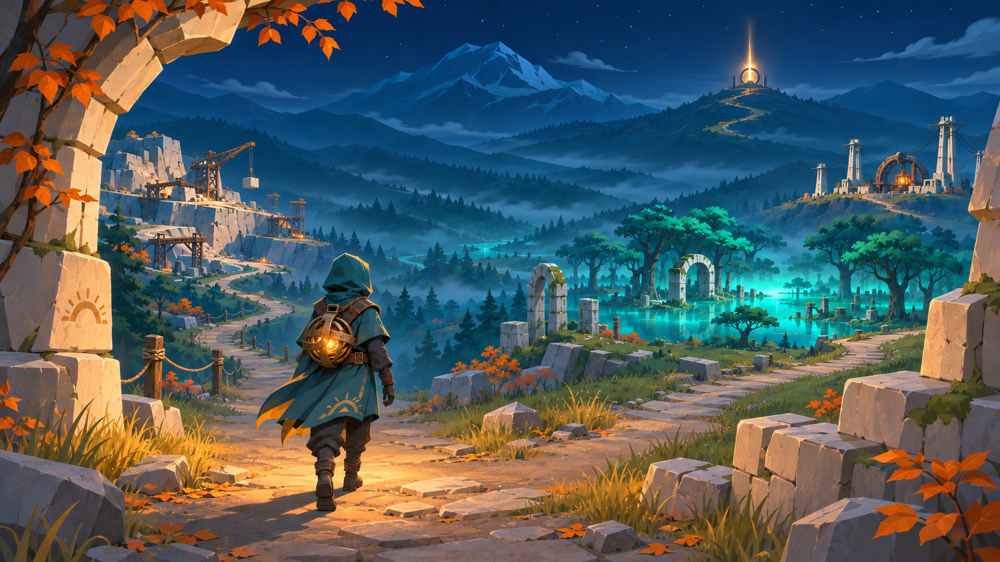

Primary exploration framing target: low third-person camera and reachable branching trails.

## The Forgotten Side Path

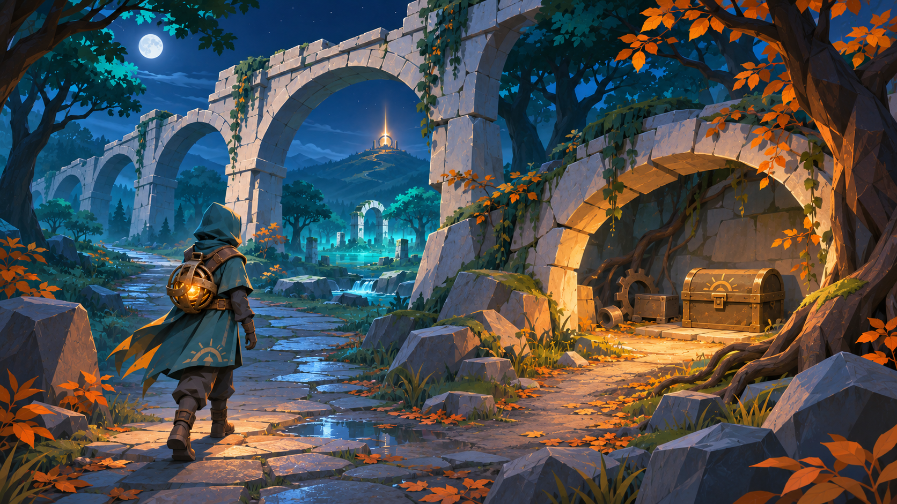

Optional supply discovery under an aqueduct; main route stays visible.

## Road to Broken Quarry

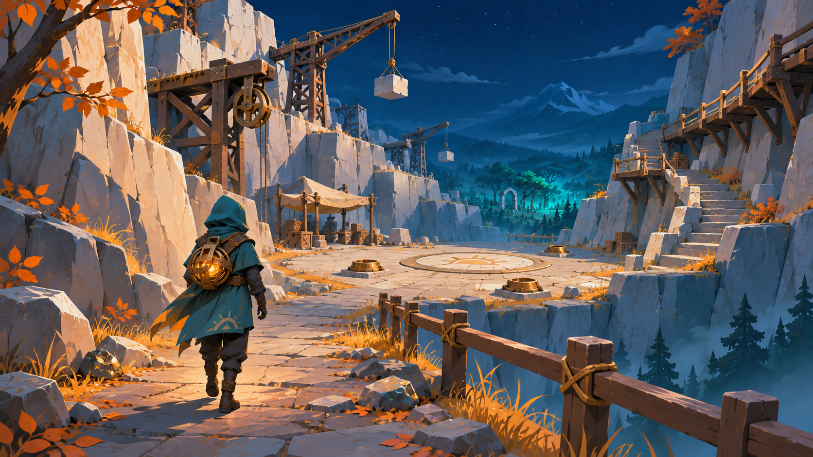

Third-person approach to an inactive camp and a high scouting route.

## Crossing the Flooded Grove

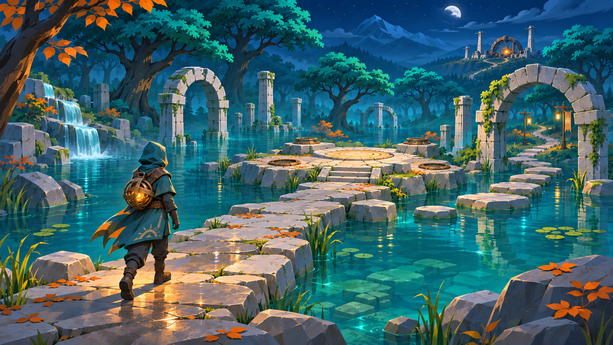

Explorable water causeways before the core is deployed.

## Ascent to Fallen Relay

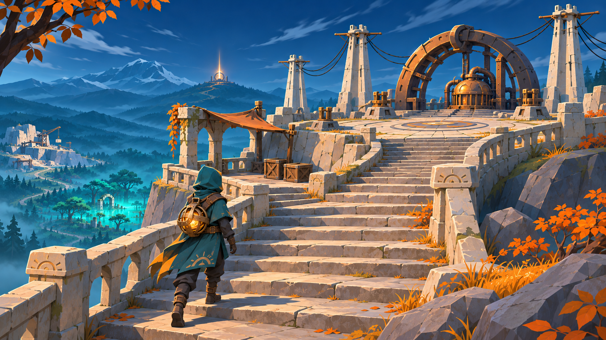

Walkable ridge stairs and distant landmarks.

## Explore, Deploy, Defend, Retreat

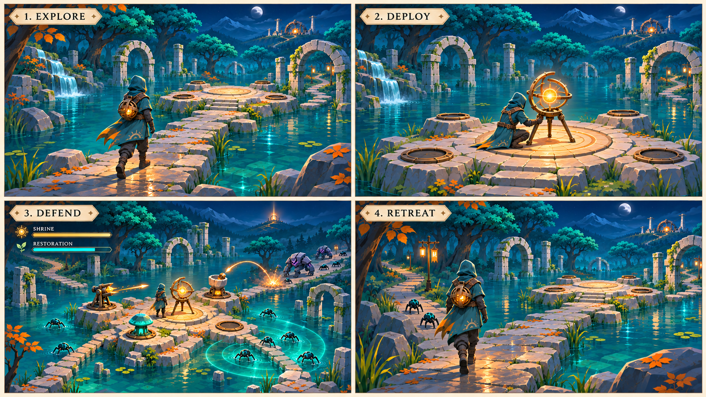

Authoritative camera-mode relationship in the same 3D world.

## Priority

For visual identity use 01, 03, 07 and 08. For third-person exploration use 11–15. For defense use 04–06. Board 16 defines the reversible camera switch. Board 02 is a world composition reference, not a metrically accurate navigation map. Preserve one authoritative sun core even when a generated reference has inconsistent decorative details. Earlier variants are in art/archive/.
