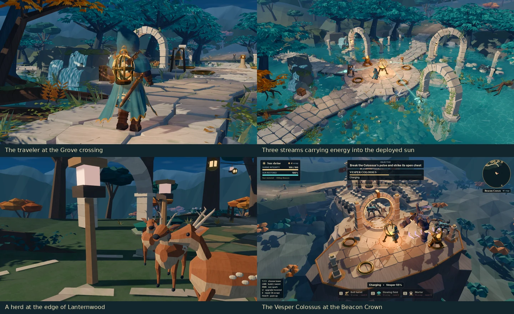
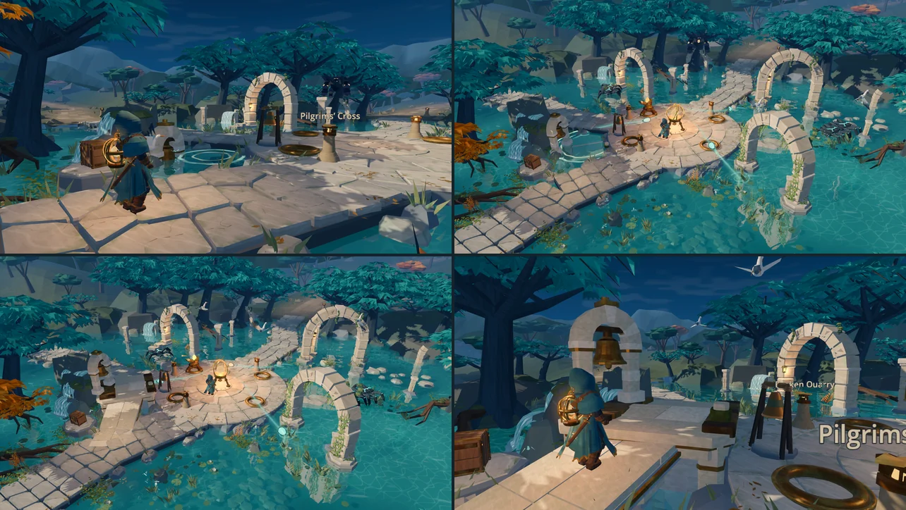

# Living Valley and the Last Guardian

The four views below are native Godot captures. They show the carried shrine, energy entering it in Flooded Grove, Lanternwood wildlife, and the required hilltop defense.



## Art and movement

The final traveler has 20,681 triangles and one painted 2,048px atlas. Front and rear renders against concept 03 led to a diagonal overlapping apron, a clearer scabbard angle, and a single embroidered crest. The crawler has 6,200 triangles, the brute 8,512, and the guardian 9,948. Comparing the first models to concept 08 led to a continuous cyan fracture across the crawler and a broken copper-edged crown on the guardian.

The native Grove comparison showed that pale paving hid parts of the energy draw. The final effect moves dark-rimmed turquoise packets from the site features into the golden rings of the existing shrine. A separate wildlife comparison caught an import that hid the animals' vertex paint. A fresh Lanternwood capture confirmed the warm coat, pale spots, and dark feet and eyes.

## Gameplay checks

| Scenario | Observed result |
| --- | --- |
| Traveler movement and shrine handling | Walk, jog, sprint, planted turns and slope contact passed. The sword combo retained its contact timings. The same sun survived deployment, packing, and delivery. |
| Wildlife | All eight species appeared in their authored habitats. Deer fled from movement and combat, returned to grazing, and stopped simulating at a distance. Wildlife remained outside combat targeting and the hostile cap. |
| Hostile trail encounters | Four seeded journeys exercised scouting, road bypass, spark activation, partial defeat, escape, and return. Cleared packs paid once. |
| Energy and defense | All seven sites handled zero, interrupted, and reduced-motion draws. The opening Grove defense extracted its full reserve in 91 seconds of simulated game time, with seven peak hostiles and 76 core health remaining. |
| Journey persistence | The title's Continue action restored the frontier layout, discovery claims, camp reserve, and threat from an isolated save. |
| Final defense | A full-restoration checkpoint from the previous version opened summit preparation. Retreat, defeat, retry, a zero-scrap spark victory, and final delivery passed. A native run fought the guardian and its escorts and reached sunrise. |

## Drowned Bell Road



Approach Flooded Grove and listen for the muffled bell. Fish scatter near the sunken arcade. After the shrine has drawn 12.5 of the Grove's 25 restoration points, amber light travels to the ruin and the roof rises to join two existing causeways. Pack the shrine and take either crossing. The new route is wide enough for a pursuing crawler to follow.

Comparing the first capture with the Grove stills led to a higher resting crown, a clearer amber pulse across the cream paving, and flush stone landings on the two causeways. The final 1080p capture used the native Mobile Vulkan renderer on Intel Arc. A 24-frame sample of the raised crossing with one pursuer averaged 11.77 ms and reached 17.43 ms at the 95th percentile.

The Grove's saved reserve determines whether the road is open. The smoke test covers partial extraction over two live defenses, retreat with the original sun, dry detours, pursuit, and reopening legacy and seeded checkpoints through Continue. It also verifies that reduced motion opens the road with a short transition.

```bash
XDG_DATA_HOME="$(mktemp -d)" CINDERTRAIL_TEST_SAVE=1 godot --headless --fixed-fps 60 --script tests/bell_road_smoke.gd
godot --fixed-fps 30 --script tools/qa/bell_road_capture.gd -- --out="$PWD/evidence/bell-road" --record-transition
```

## Native performance

Godot 4.7.2 on Linux, Mobile Vulkan, Intel Core Ultra 7 255H with integrated Intel Arc graphics, 1,920 × 1,080. Times are wall time between rendered frames with vsync enabled.

| Encounter | Sample | Peak hostiles | Mean | p95 | Worst |
| --- | ---: | ---: | ---: | ---: | ---: |
| Fallen Relay, wave six and four modules | 240 frames | 14 | 10.89 ms | 15.05 ms | 23.54 ms |
| Beacon Crown, guardian and both escorts | 150 frames | 3 | 10.16 ms | 13.92 ms | 19.28 ms |
| Fallen Relay, separate verbose launch with fresh shader-cache directory | 240 frames | 14 | 18.67 ms | 25.51 ms | 30.38 ms |

The previous Relay sample measured 13.33 ms p95 with 13 hostiles. The fresh-directory run logged Vulkan shader-cache misses. The original capture reported retained objects at shutdown. The separate verbose launch exited cleanly. These short native checks cover encounter behavior and rendering. Full-campaign difficulty with the expanded roster still needs human playtesting.

To repeat the native checks, run `godot --script tools/qa/runtime.gd -- --case=relay-profile --out=/tmp/cinder-relay` or substitute `dawn` for the summit. The `atelier` case captures the traveler and the Grove. The `wildlife` case captures the animals in Lanternwood.
