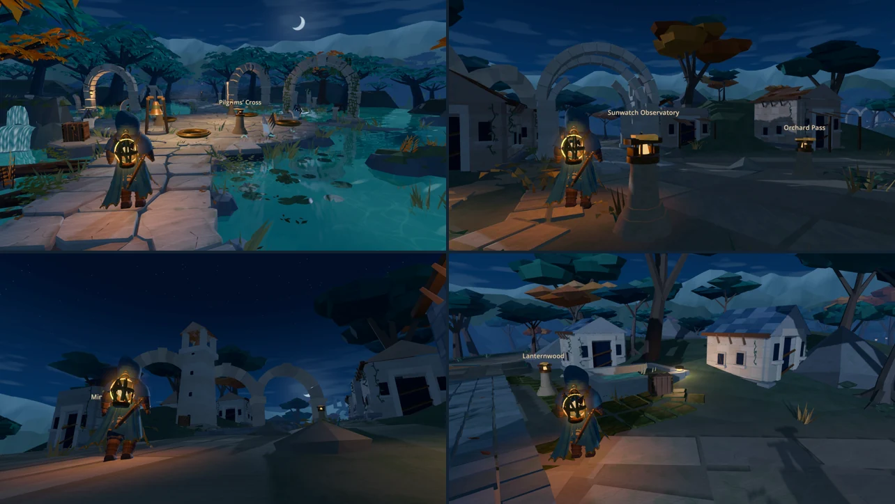

# The Valley Before Dawn

## Play

Start a New Journey for the new forests, settlements, and trail forks. The map and waymarks show the selected branches. Western Arcade, Bellmakers’ Steps, and Mineral Ward each have a side street that returns to the main road. Search it for supplies.

Extract the last of a shrine's energy to learn its ability and raise every defense's upgrade cap. **G** casts and **Q** cycles. **Space** begins a defense and can finish a shrine after the sun reaches 100%. After the Vesper Colossus falls, press **E** at the cradle to trigger the 26-second ending. **Esc**, **Enter**, or the on-screen button skips to the result. Reduced motion uses fixed framing and dissolves.

## Verification

| Check | Observed result |
| --- | --- |
| Valley generation | 1,000 seeds selected all 24 base-valley and trail-fork combinations. The traveler walked all 18 crossing variants both ways. The previous 17-road layout passed both directions and its district joins. |
| Towns | The traveler walked all 24 selected town loop configurations. All three caches paid 14 scrap each, and Continue restored the claims. |
| Progression | The title, legacy Continue, Retry, half-finished Grove, held wave at 100%, and optional local finish passed. Packing before the first enemy spawn grants no draw. All three tower types reach level 10 with seven completed shrines. The seven ability checks use the actual site IDs. |
| Beacon | The original sun reaches the cradle with the harness empty. Full playback, immediate and mid-scene skip, reduced motion, and interrupted playback passed. Continue after interruption starts on the cleared summit. |
| Continuous journey | An automated seed 80 run walked from the Grove through Lanternwood, the Aqueduct, and Sunwatch, then defeated the Colossus and delivered the sun. It took 12 minutes and 15 seconds of simulated play. |

The Grove comparison uses the same exploration and tactical cameras. Lower cool moonlight deepens shadows across the arches and separates amber core light from the paths. The first town captures led to deeper masonry, roof braces, ivy, and wooded street edges. The finale capture exposed an obscured harness and traveler. The final cameras keep both visible. [Godot renderer features](https://docs.godotengine.org/en/stable/tutorials/rendering/renderers.html) · [Beacon playback checks](../tools/qa/README.md)

## Native frame time

Godot 4.7.2 Mobile Vulkan on Intel Arc (ARL), Wayland, 1920 × 1080. The matched static samples measure elapsed time between rendered frames with vsync. The Grove uses 32 measured frames per condition. The towns use 48 and switch the new dressing off and on with the same moonlight and camera.

| View | Baseline p95 | New p95 |
| --- | ---: | ---: |
| Grove approach | 15.24 ms | 14.45 ms |
| Grove defense | 15.29 ms | 15.69 ms |
| Western Arcade | 32.81 ms | 33.07 ms |
| Bellmakers’ Steps | 27.29 ms | 30.23 ms |
| Mineral Ward | 25.73 ms | 26.39 ms |

The first repeated Mineral Ward comparison exceeded the 10% wall-clock target. The final pass simplifies cistern shading, culls distant supplemental trees sooner, and omits supplemental foliage from the shadow pass. In that sample Mineral Ward added 2.6% to wall-clock p95 and Bellmakers’ Steps added 10.8%. Host load varied between runs. Mineral Ward still added about 6.94 ms to the GPU p95 in the final sample.

Repeat the native comparison with `godot --script tools/qa/moonlit_valley_capture.gd -- --out="$PWD/evidence/moonlit-valley" --repeat`. Full-campaign balance with high-level towers still needs an uninterrupted human playthrough.
