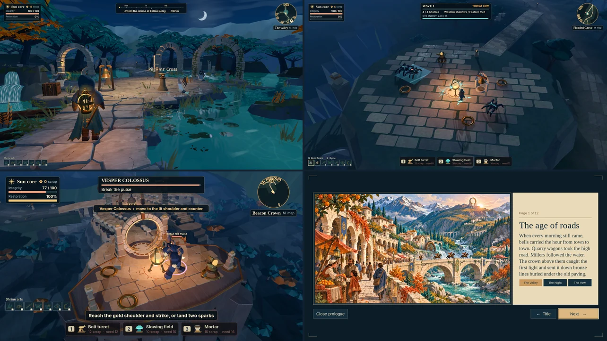

# Traveler’s Reckoning

**Space** jumps in either camera. Press **Shift** to dash and hold it to sprint. **T** starts or resumes an attack. The exploration compass shows the next turn and distance along the route to the objective. The raised Bell Road and opened winches change that route.

**Q** cycles the learned arts. **G** casts the selected art. Each icon shows its own cooldown. Fully extracting a shrine also records the first unlock in the profile’s **Achievements** shelf, accessible from title and pause.

At the summit, move to Vesper’s lit shoulder during the brace window. Use one close strike or two sparks to expose the chest. An unattended defense loses even with a tower firing. A zero-scrap traveler won in 94.7 seconds with 62 shrine health left after one deliberate missed pulse. A traveler with level-three modules won in 31.2 seconds with 68 shrine health. Both runs completed the three phases and reached the original sun’s delivery.

## Verified in Godot

| Area | Coverage |
| --- | --- |
| Traversal | 15 movement checks including buffered takeoff, late takeoff, slopes, walls, ledges, void recovery, and the restored summit checkpoint. The Quarry supply alcove, stairs, timber deck, and Summit rails gained missing collision. Terrain tests took 280,890 floor samples across seven fixtures. |
| Compass | Legacy and seeded layouts, seven shrine destinations, the beacon, closed and open gates, no bearing in a void, and the real traveler following the bearing across Bell Road. |
| Abilities | 39 combat and profile checks and 16 live shrine/Continue checks cover independent cooldowns, sword recovery, shared dash collision, legacy migration, and one-time achievements. |
| Guardian | Three phases, tower-only defeat, wrong-side counters, jump and safe gap around the ring, retreat, retry, one-core delivery, ending playback, and skip. |
| HUD and comic | Native captures at 720p, 1080p, and 21:9 verify the compass, icons, wave strip, and modal spacing. All twelve pages render with live captions. Keyboard navigation, replay, skip, and reduced motion passed. |

The tactical rim was reviewed against the amber core and blue cloak. The clear contact flash appears during a strike and the steady rim fades when the traveler packs up. The comic uses eight original OpenAI-generated paintings and four existing illustrations. [Artwork prompts](../art/comic/reckoning/README.md)

## Native frame time

The Godot 4.7.2 Mobile Vulkan run used Intel Arc (ARL) at 1920 × 1080. In a 32-frame warmed sample with three enemies, showing the HUD measured 18.21 ms mean and 36.60 ms p95. Hiding it measured 19.48 ms mean and 33.83 ms p95. The sample describes one short defense. The separate prologue capture logged five retained Godot objects at exit.

Run `godot --path .` to play the current project. Test fixtures are under `tests/` and the native HUD runner is `tools/qa/traveler_hud.gd`.
